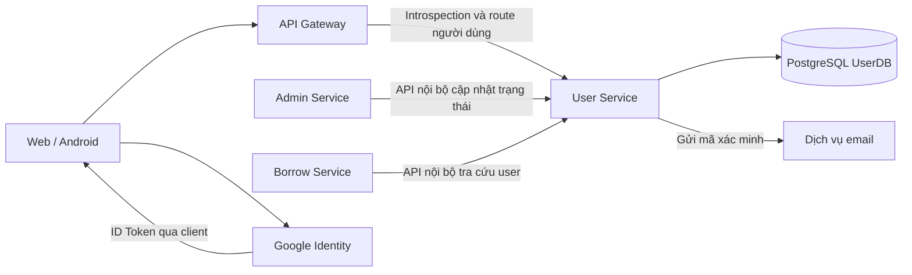

# Kiến trúc và phạm vi

Trạng thái: kiến trúc mục tiêu; [nền tảng bảo mật/login UC02](user-security.md) đã triển khai ngày 2026-11-10; refresh/logout UC03–UC04 bổ sung ngày 2026-11-11, GET/PATCH hồ sơ UC06 bổ sung ngày 2026-11-12, đổi mật khẩu UC07 ngày 2026-11-13; 14 operation khác còn thiết kế. Bản bàn giao 2026-10-24/25 ghi trạng thái V6 theo xác nhận chủ dự án; đợt UC02 không thay migration/database dự án.

## Ranh giới trách nhiệm

**Thứ tự triển khai chốt ngày 2026-11-10:** [các service mặc định tin tưởng nhau khi code chức năng](confirmed-decisions.md#deferred-service-auth), tạm chưa xác thực danh tính/quyền service cho Admin/Borrow/Gateway. Bổ sung Service JWT sau khi hoàn tất tất cả chức năng; các yêu cầu xác thực service bên dưới là kiến trúc đích của bước sau. User JWT, phiên, ownership và actor ADMIN vẫn áp dụng. Đợt UC02 đã bổ sung nền tảng user security; Service JWT và ba endpoint nội bộ vẫn chưa triển khai.

Phạm vi 2026-10-19 gồm 7 bảng, 20 API thiết kế. Chính sách tài khoản và giới hạn chức năng được duy trì tại [sổ quyết định](confirmed-decisions.md#phạm-vi); tra cứu HTTP tại [bản đồ API](api/README.md).

| Thành phần | Trách nhiệm | Căn cứ và trạng thái |
| --- | --- | --- |
| User Service | Đăng ký, xác minh email, đăng nhập local/Google, token, hồ sơ, mật khẩu, quản lý phiên | UC01–UC12, thiết kế nguồn |
| User Service | Lưu tài khoản, role, liên kết đăng nhập, hash token và mã xác minh | Migration V1–V6 có trong repo; V6 đã áp dụng vào database dự án theo xác nhận của chủ dự án ngày 2026-10-25; xem [mô hình dữ liệu](data-model.md#migration-v6-quản-lý-phiên) |
| Admin Service | Khởi xướng và điều phối khóa, mở khóa/kích hoạt lại | Chủ dự án xác nhận |
| User Service | API ghi trạng thái theo yêu cầu Admin Service đã được xác thực và cấp quyền | API trạng thái có trong Excel; quản lý role qua API ngoài V1 |
| Gateway | Xác thực request người dùng qua introspection và định tuyến tới service đích | Dùng Service JWT riêng gọi User Service; chưa triển khai |
| Borrow Service | Kiểm tra điều kiện nghiệp vụ mượn từ thông tin user nhận được | Excel Sheet1 hàng 18 |
| Web/Android | Gọi API người dùng, giữ/xóa token theo luồng đăng nhập | Thiết kế nguồn; cách lưu token chưa chốt |
| Google | Cung cấp danh tính đăng nhập ngoài | UC08 |
| Dịch vụ gửi email | Gửi mã đăng ký, khôi phục và thiết lập mật khẩu | UC01, UC05, UC09; SMTP đồng bộ sau commit OTP đã chốt ngày 2026-10-31, nhà cung cấp/cấu hình môi trường còn mở |

## Luồng tích hợp mục tiêu

Sơ đồ thể hiện thiết kế, không khẳng định các kết nối đã được triển khai.

Thiết kế tích hợp dùng API User Service để truy cập dữ liệu user. Không có hợp đồng cho phép Admin Service hoặc Borrow Service ghi trực tiếp UserDB. API nội bộ vẫn phải xác thực và phân quyền; tiền tố `/internal` tự nó không tạo ra bảo vệ.

Ngày 2026-10-31 chốt [Service JWT/quyền riêng cho Admin/Borrow và access token actor Admin](confirmed-decisions.md#internal-service-auth), [SMTP sau commit](confirmed-decisions.md#otp-email-delivery), [retry/cạnh tranh/audit trạng thái](confirmed-decisions.md#admin-status-contract) và [user access token Q14](confirmed-decisions.md#access-token-key-pair). User token dùng issuer chung, audience Library API, kid và file khóa; chỉ cấu hình Service JWT còn PENDING DECISION. Chưa triển khai các kết nối này.

## Hiện trạng kỹ thuật

`backend/pom.xml` khai báo Java 25 và Spring Boot 4.1.1, cùng Web MVC, Security, Validation, Data JPA, Flyway và PostgreSQL driver. Đây là phiên bản repo đang dùng, không phải tuyên bố về phiên bản mới nhất của các công nghệ.

`application.yml` đặt cổng 5001, import `.env` tùy chọn. Hibernate validate schema; Flyway quản lý schema. Đã có JWT RS256, Argon2id, Bearer và login UC02. Google, email, Gateway, discovery, message broker, Docker và CI chưa có. [OpenAPI/Swagger UI](api/openapi.md) giữ đủ 20 operation, login/refresh/logout, GET/PATCH hồ sơ UC06 và đổi mật khẩu UC07 `IMPLEMENTED`, 14 operation khác `DESIGN_ONLY`.

JWT và user/phiên được xác minh bởi [nền tảng bảo mật](user-security.md); role đọc hiện tại từ database, không chứa trong JWT. Chưa có health endpoint hoặc Actuator.

Ngày 2026-11-03 đã triển khai [nền tảng backend theo chức năng](foundation.md): entity/repository, DTO cho 20 API, envelope, validation và xử lý exception. Ngày 2026-11-10 thêm controller/service login và security stateless: GET tài liệu/login công khai; ngày 2026-11-11 mở thêm refresh/logout, các request còn lại được bảo vệ; không mở endpoint nội bộ chưa triển khai.

## Những ranh giới cần giữ khi triển khai

API cập nhật hồ sơ không được trở thành đường sửa `roles`, `status`, `password`, username hoặc email ngoài hợp đồng đã chốt. Cấp `READER` khi đăng ký là quy tắc đăng ký trong nguồn, cần phân biệt với chức năng gán quyền quản trị.

Gateway gọi introspection để User Service xác minh JWT và trạng thái user/phiên. Danh tính Gateway tách khỏi user token được kiểm tra; service nghiệp vụ vẫn kiểm tra quyền trên dữ liệu. Không cho client đi vòng vào backend hoặc tin header danh tính tùy ý. Xem [hợp đồng Gateway](api/sessions.md#danh-tính-gateway-và-vận-hành).

Chính sách [token](confirmed-decisions.md#user-tokens) và [thời hạn phiên](confirmed-decisions.md#session-lifetime) được duy trì ở sổ quyết định. Thu hồi refresh token đơn thuần không vô hiệu JWT; thiết kế kiểm tra phiên ở lần introspection sau commit. Không cam kết hủy request đã qua kiểm tra. Nền tảng Bearer đã kiểm tra phiên; UC04 đã thu hồi phiên và refresh token ngày 2026-11-11. Các API quản lý phiên và introspection/Gateway chưa triển khai.
