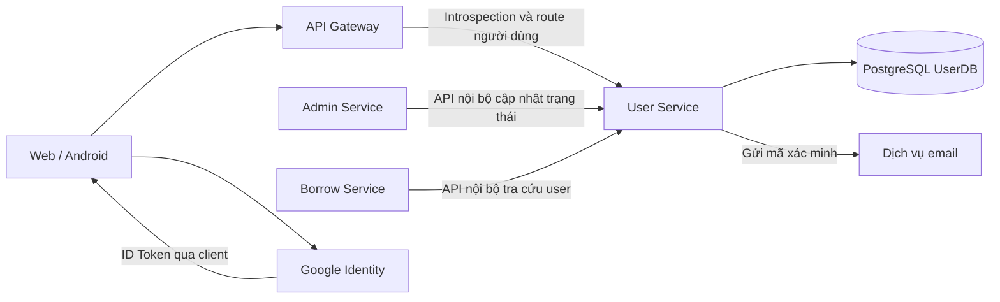

# Kiến trúc và phạm vi

## Ranh giới trách nhiệm

Phạm vi 2026-10-19: 7 bảng, 20 API thiết kế, gồm 4 API mới về phiên/introspection. Admin Service điều phối khóa/mở khóa; kích hoạt là BANNED → ACTIVE. Quản lý role qua API vẫn ngoài phạm vi. Web/Android giữ refresh token trong JSON. Xem [hiện trạng và tích hợp phiên](api/sessions.md).

| Thành phần | Trách nhiệm | Căn cứ và trạng thái |
| --- | --- | --- |
| User Service | Đăng ký, xác minh email, đăng nhập local/Google, token, hồ sơ, mật khẩu, quản lý phiên | UC01–UC12, thiết kế nguồn |
| User Service | Lưu tài khoản, role, liên kết đăng nhập, hash token và mã xác minh | Migration V1–V6 có trong repo; V6 chưa áp dụng vào database dự án |
| Admin Service | Khởi xướng và điều phối khóa, mở khóa/kích hoạt lại | Chủ dự án xác nhận |
| User Service | API ghi trạng thái theo yêu cầu Admin Service đã được xác thực và cấp quyền | API trạng thái có trong Excel; quản lý role qua API ngoài V1 |
| Borrow Service | Kiểm tra điều kiện nghiệp vụ mượn từ thông tin user nhận được | Excel Sheet1 hàng 18 |
| Web/Android | Gọi API người dùng, giữ/xóa token theo luồng đăng nhập | Thiết kế nguồn; cách lưu token chưa chốt |
| Google | Cung cấp danh tính đăng nhập ngoài | UC08 |
| Dịch vụ gửi email | Gửi mã đăng ký, khôi phục và thiết lập mật khẩu | UC01, UC05, UC09; phương thức tích hợp chưa chốt |

## Luồng tích hợp mục tiêu

Sơ đồ thể hiện thiết kế, không khẳng định các kết nối đã được triển khai.

Thiết kế tích hợp dùng API User Service để truy cập dữ liệu user. Không có hợp đồng cho phép Admin Service hoặc Borrow Service ghi trực tiếp UserDB. API nội bộ vẫn phải xác thực và phân quyền; tiền tố `/internal` tự nó không tạo ra bảo vệ.

## Hiện trạng kỹ thuật

`backend/pom.xml` khai báo Java 25 và Spring Boot 4.1.1, cùng Web MVC, Security, Validation, Data JPA, Flyway và PostgreSQL driver. Đây là phiên bản repo đang dùng, không phải tuyên bố về phiên bản mới nhất của các công nghệ.

`application.yml` đặt cổng 5001, import `.env` tùy chọn. Hibernate validate schema; Flyway quản lý schema. Chưa có cấu hình/code JWT, Google, email, Gateway, discovery, message broker, Docker hoặc CI. Đợt này chỉ migration và docs.

JWT và phiên sẽ được xác minh khi triển khai API; chưa có các lớp này trong repo. Chưa có health endpoint hoặc Actuator.

## Những ranh giới cần giữ khi triển khai

API cập nhật hồ sơ không được trở thành đường sửa `roles`, `status`, `password`, username hoặc email ngoài hợp đồng đã chốt. Cấp `READER` khi đăng ký là quy tắc đăng ký trong nguồn, cần phân biệt với chức năng gán quyền quản trị.

Thiết kế JWT access token ký RS256 bằng Private Key của User Service; Gateway gọi introspection để User Service xác minh JWT và phiên. Public Key phục vụ xác minh khi các service cần; không thay thế phân quyền nghiệp vụ. TTL access token 1 giờ và refresh token 7 ngày đã chốt ngày 2026-10-20; Session có hạn cố định 30 ngày, không gia hạn khi refresh; token chỉ dùng được khi session còn hiệu lực. Refresh token opaque lưu hash trong PostgreSQL và rotation. Chưa có cấu hình thực thi.

Thu hồi refresh token không tự vô hiệu JWT. Đã chọn Gateway introspection và Service JWT xác thực Gateway, chưa có implementation. Không có JWT blacklist hoặc Redis. Xem [quyết định đã xác nhận](confirmed-decisions.md).
