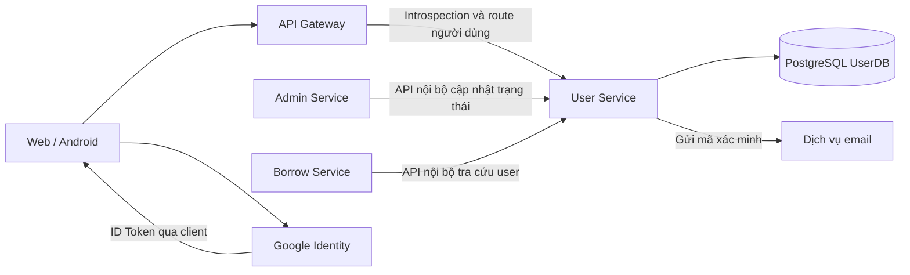

# Kiến trúc và phạm vi

Trạng thái: kiến trúc mục tiêu, chưa triển khai API. Biên tập ngày 2026-10-24 dựa trên code/config trong repo và các quyết định đã xác nhận; không kiểm tra database trong đợt này.

## Ranh giới trách nhiệm

Phạm vi 2026-10-19 gồm 7 bảng, 20 API thiết kế. Chính sách tài khoản và giới hạn chức năng được duy trì tại [sổ quyết định](confirmed-decisions.md#phạm-vi); tra cứu HTTP tại [bản đồ API](api/README.md).

| Thành phần | Trách nhiệm | Căn cứ và trạng thái |
| --- | --- | --- |
| User Service | Đăng ký, xác minh email, đăng nhập local/Google, token, hồ sơ, mật khẩu, quản lý phiên | UC01–UC12, thiết kế nguồn |
| User Service | Lưu tài khoản, role, liên kết đăng nhập, hash token và mã xác minh | Migration V1–V6 có trong repo; V6 chưa áp dụng vào database dự án theo bàn giao 2026-10-22 |
| Admin Service | Khởi xướng và điều phối khóa, mở khóa/kích hoạt lại | Chủ dự án xác nhận |
| User Service | API ghi trạng thái theo yêu cầu Admin Service đã được xác thực và cấp quyền | API trạng thái có trong Excel; quản lý role qua API ngoài V1 |
| Gateway | Xác thực request người dùng qua introspection và định tuyến tới service đích | Dùng Service JWT riêng gọi User Service; chưa triển khai |
| Borrow Service | Kiểm tra điều kiện nghiệp vụ mượn từ thông tin user nhận được | Excel Sheet1 hàng 18 |
| Web/Android | Gọi API người dùng, giữ/xóa token theo luồng đăng nhập | Thiết kế nguồn; cách lưu token chưa chốt |
| Google | Cung cấp danh tính đăng nhập ngoài | UC08 |
| Dịch vụ gửi email | Gửi mã đăng ký, khôi phục và thiết lập mật khẩu | UC01, UC05, UC09; phương thức tích hợp chưa chốt |

## Luồng tích hợp mục tiêu

Sơ đồ thể hiện thiết kế, không khẳng định các kết nối đã được triển khai.

Thiết kế tích hợp dùng API User Service để truy cập dữ liệu user. Không có hợp đồng cho phép Admin Service hoặc Borrow Service ghi trực tiếp UserDB. API nội bộ vẫn phải xác thực và phân quyền; tiền tố `/internal` tự nó không tạo ra bảo vệ.

## Hiện trạng kỹ thuật

`backend/pom.xml` khai báo Java 25 và Spring Boot 4.1.1, cùng Web MVC, Security, Validation, Data JPA, Flyway và PostgreSQL driver. Đây là phiên bản repo đang dùng, không phải tuyên bố về phiên bản mới nhất của các công nghệ.

`application.yml` đặt cổng 5001, import `.env` tùy chọn. Hibernate validate schema; Flyway quản lý schema. Chưa có cấu hình/code JWT, Google, email, Gateway, discovery, message broker, Docker hoặc CI. Đợt này chỉ migration và docs.

JWT và phiên sẽ được xác minh khi triển khai API; chưa có các lớp này trong repo. Chưa có health endpoint hoặc Actuator.

## Những ranh giới cần giữ khi triển khai

API cập nhật hồ sơ không được trở thành đường sửa `roles`, `status`, `password`, username hoặc email ngoài hợp đồng đã chốt. Cấp `READER` khi đăng ký là quy tắc đăng ký trong nguồn, cần phân biệt với chức năng gán quyền quản trị.

Gateway gọi introspection để User Service xác minh JWT và trạng thái user/phiên. Danh tính Gateway tách khỏi user token được kiểm tra; service nghiệp vụ vẫn kiểm tra quyền trên dữ liệu. Không cho client đi vòng vào backend hoặc tin header danh tính tùy ý. Xem [hợp đồng Gateway](api/sessions.md#danh-tính-gateway-và-vận-hành).

Chính sách [token](confirmed-decisions.md#user-tokens) và [thời hạn phiên](confirmed-decisions.md#session-lifetime) được duy trì ở sổ quyết định. Thu hồi refresh token đơn thuần không vô hiệu JWT; thiết kế kiểm tra phiên ở lần introspection sau commit. Không cam kết hủy request đã qua kiểm tra; chưa có implementation.
