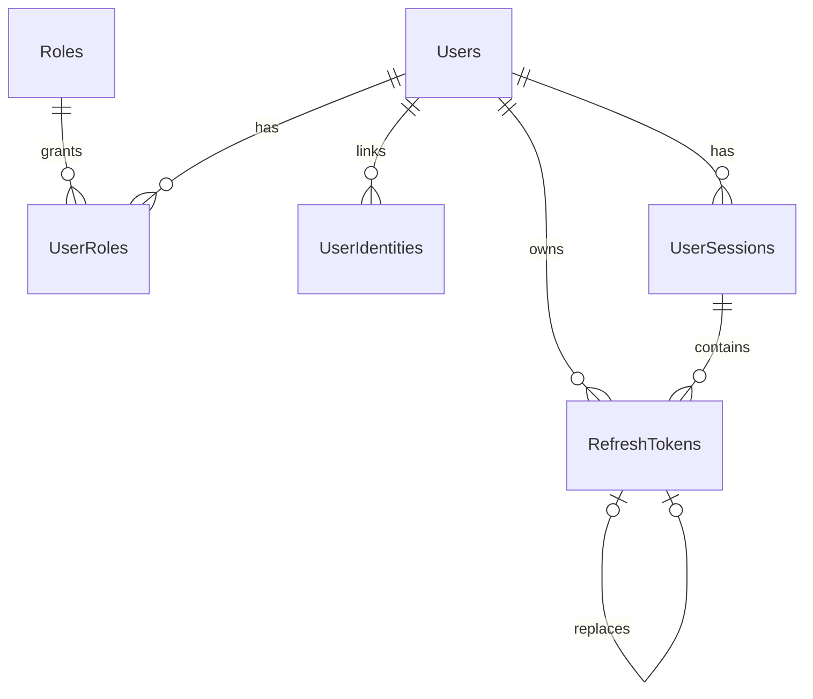

# Mô hình dữ liệu theo migration

Nguồn: [Flyway migrations](../backend/src/main/resources/db/migration/), V1–V6. V6 có trong repo; theo bàn giao 2026-10-22 chưa áp dụng vào database dự án. Biên tập ngày 2026-10-24 chỉ đối chiếu file, không kiểm tra database. Chưa có entity/API nghiệp vụ. Tên bảng/cột PostgreSQL dùng dấu nháy kép.

| Bảng | Cột chính | Ràng buộc và ý nghĩa |
| --- | --- | --- |
| Users | Id; UserName varchar(50); Email varchar(255); PasswordHash varchar(255), nullable; FullName varchar(150); PhoneNumber varchar(20), nullable; Status varchar(20); CreatedAt/UpdatedAt timestamptz | Id integer identity; username/email duy nhất; status ACTIVE hoặc BANNED, mặc định ACTIVE |
| Roles | Id integer identity; Name varchar(30) | Tên duy nhất; seed READER, LIBRARIAN, ADMIN |
| UserRoles | UserId, RoleId | Khóa chính ghép; quan hệ nhiều–nhiều, FK xóa cascade |
| UserIdentities | Id; UserId; Provider varchar(30); ProviderUserId varchar(255); CreatedAt | Duy nhất (Provider, ProviderUserId) và (UserId, Provider); FK user xóa cascade |
| RefreshTokens | Id; UserId; SessionId UUID; TokenHash varchar(255); ExpiresAt; RevokedAt nullable; CreatedAt; ReplacedByTokenId nullable | Hash duy nhất; SessionId bắt buộc/bất biến từ V6; token thay thế cùng user/phiên, Id lớn hơn, chỉ thay một token cũ; FK user xóa cascade |
| VerificationCodes | Id; Email varchar(255); Purpose varchar(30); CodeHash varchar(255); ExpiresAt; UsedAt nullable; AttemptCount; CreatedAt | Purpose REGISTER/PASSWORD_RESET/SET_PASSWORD; số lần thử không âm; không FK Users vì đăng ký xảy ra trước khi có user |
| UserSessions | Id UUID; UserId; CreatedAt/ExpiresAt/LastSeenAt; RevokedAt nullable; RevocationReason varchar(50), nullable; DeviceName varchar(150), ClientType varchar(20), UserAgent varchar(1024), nullable | V6; chủ sở hữu bắt buộc; client type WEB/ANDROID nếu có; thông tin thiết bị chỉ là metadata |

VerificationCodes liên hệ theo email và purpose ở tầng ứng dụng, không có quan hệ FK trong sơ đồ.

## Migration V6 quản lý phiên

[V6__create_user_sessions.sql](../backend/src/main/resources/db/migration/V6__create_user_sessions.sql) lấy khóa bảng RefreshTokens và dừng ngay nếu có bất kỳ bản ghi nào, kể cả đã hết hạn/thu hồi. Không tự xóa/thu hồi token, không backfill phiên giả. Phải chạy bằng transaction của Flyway; không chạy từng statement thủ công. Trạng thái áp dụng database cần kiểm tra theo môi trường thực tế; đợt tối ưu docs không chạy migration.

UserSessions.Id do backend tạo UUID khi triển khai đăng nhập, không tự sinh UUID hoặc TTL trong migration. ExpiresAt phải sau CreatedAt; LastSeenAt và RevokedAt không được trước CreatedAt. Phiên chưa thu hồi phải có RevocationReason NULL; phiên đã thu hồi cần lý do không trống. Lý do là mã nội bộ được backend chọn, không nhận tùy ý từ client; danh sách mã chi tiết chưa bị cố định bằng enum SQL.

Các mã lý do đã có trong bản Word đối chiếu 2026-10-22: UC04 `LOGOUT`, UC05 `PASSWORD_RESET`, UC07 `PASSWORD_CHANGED`, UC09 `PASSWORD_SET`. Giữ các mã này khi triển khai luồng tương ứng. Mã cho khóa tài khoản và UC11/UC12 cần thống nhất khi hoàn thiện hợp đồng; không suy ra danh sách enum SQL từ các ví dụ. Thu hồi lặp không ghi đè thời điểm/lý do cũ theo quy tắc UC04/UC11.

RefreshTokens thêm **SessionId UUID NOT NULL**. FK `(SessionId, UserId)` trỏ tới UserSessions bảo đảm chủ sở hữu khớp. FK thay thế `(ReplacedByTokenId, UserId, SessionId)` yêu cầu token mới cùng user và cùng phiên; giữ các ràng buộc tuyến tính từ V4. Trigger không cho thay SessionId của token đã tạo. Xóa token thay thế chỉ bỏ ReplacedByTokenId, giữ nguyên UserId và SessionId của token cũ.

Xóa một session còn refresh token tham chiếu bị FK chặn; thu hồi phải UPDATE phiên/token, không DELETE phiên. Xóa user có cascade theo các FK đã định nghĩa. Có index theo UserId/CreatedAt/Id, ExpiresAt của phiên và SessionId của token. Không có bảng Devices riêng hoặc cột IP trong V6.

Schema chưa tự kiểm tra trạng thái user/phiên khi dùng token, chưa cập nhật LastSeenAt theo request và chưa thu hồi token khi khóa user. Những hành vi đó thuộc bước code API tiếp theo, với transaction và kiểm soát cạnh tranh giữa login/refresh/revoke.

Backend phải áp dụng [thời hạn session/token đã chốt](confirmed-decisions.md#session-lifetime) và từ chối dùng token khi phiên hết hiệu lực. Đây là quy tắc ứng dụng dự kiến, không phải constraint/default TTL trong migration; không cần sửa V6.

**Kết quả kiểm tra lịch sử được bàn giao ngày 2026-10-19**, trên PostgreSQL 18 tạm riêng: V1–V6 chạy thành công khi token rỗng; V6 bị chặn khi còn token và giữ nguyên dữ liệu/schema. Đã kiểm tra FK khác user/phiên, SessionId bắt buộc/bất biến, constraint thời gian/lý do, xóa token thay thế giữ ownership và cascade khi xóa user. Đây là kiểm tra SQL migration, không phải kiểm thử API; database dự án không bị thay đổi trong lần kiểm tra được ghi nhận đó. Repo chưa kèm script/log tái hiện các ca này; đợt tối ưu docs không chạy lại hoặc xác nhận lại kết quả.

## Chuẩn hóa và kiểm tra

V3 đặt các ràng buộc chuẩn hóa username/email, role/provider và dữ liệu hồ sơ. Xem [lưu ý triển khai](#lưu-ý-cho-bước-triển-khai-backend) để chuẩn hóa đúng trước lưu/tra cứu; không dùng constraint thay validation email/password/phone ở ứng dụng.

ProviderUserId và các hash là dữ liệu nguyên dạng, không lowercase/trim để sửa dữ liệu. PasswordHash NULL dành cho tài khoản chưa có password.

## Token và thời gian

ExpiresAt phải sau CreatedAt. RevokedAt/UsedAt nếu có không được trước CreatedAt. Khi rotation, cập nhật token cũ và tạo token mới cần cùng transaction cùng cơ chế kiểm soát cạnh tranh ở backend; constraint không tự triển khai toàn bộ luồng.

V4 dùng FK ghép và `ON DELETE SET NULL ("ReplacedByTokenId")`, cần PostgreSQL 15 trở lên. Xóa token thay thế chỉ xóa liên kết, không xóa chủ sở hữu token cũ. Không reset sequence để tái dùng Id thấp hơn. Tác vụ dọn phải tuân thủ [retention đã chốt](confirmed-decisions.md#refresh-retention), không suy ra lịch dọn từ index hoặc hạn riêng của token.

V5 cập nhật Users.UpdatedAt bằng trigger khi dữ liệu khác thực sự đổi; cập nhật riêng UpdatedAt hoặc cập nhật không đổi dữ liệu giữ timestamp cũ. ORM cần đọc lại nếu response phải chứa timestamp mới do database sinh. Thay đổi UserRoles không trực tiếp cập nhật hàng Users, vì vậy không mặc định coi UpdatedAt là phiên bản quyền.

## Khoảng trống so với nghiệp vụ

Schema hỗ trợ nhiều role và phiên; [giới hạn phạm vi](confirmed-decisions.md#phạm-vi) không cho phép tự thêm API role, bảng audit/đăng ký tạm, Redis hoặc JWT blacklist. Quy tắc ứng dụng chưa được schema thực thi tự động.

AttemptCount chỉ có ràng buộc không âm; giới hạn thử mã và rate limit phải nằm trong thiết kế backend. Không có constraint tự chặn token/mã hết hạn khi được sử dụng; ứng dụng phải kiểm tra.

Không sửa migration đã áp dụng trên môi trường dùng chung. Thay đổi schema bằng migration phiên bản tiếp theo và kiểm tra dữ liệu hiện có trước khi áp dụng; không xóa Flyway history để bỏ qua lỗi.

## Lưu ý cho bước triển khai backend

Sau V3, backend cần chuẩn hóa username/email thành chữ thường, tên role và provider thành chữ hoa trước khi lưu và tra cứu; provider Google dùng giá trị `GOOGLE`. Các trường định danh này không rỗng, không có whitespace hoặc control character; username không chứa `@`. FullName được trim, không rỗng hoặc chứa control character, vẫn cho khoảng trắng giữa các từ. Database từ chối giá trị chưa đúng dạng chuẩn. Quy tắc khoảng trắng và ký tự điều khiển dùng các lớp POSIX của PostgreSQL, có phân loại Unicode phụ thuộc locale. Kiểm tra định dạng email và chính sách mật khẩu vẫn thuộc backend; migration không sửa hash hoặc `ProviderUserId` và vẫn cho phép `PasswordHash = NULL` cho tài khoản đăng nhập ngoài.

Với ô đăng nhập chung, backend phân loại dữ liệu có `@` là email, còn lại là username, rồi chuẩn hóa và tra cứu theo trường tương ứng. Cần kiểm tra định dạng email ở backend; ràng buộc database hiện tại không thay thế bước này.

Sau V4, backend cần tạo token mới bằng identity tăng dần và cập nhật đồng thời `RevokedAt`, `ReplacedByTokenId` của token cũ trong cùng transaction, kèm khóa bản ghi hoặc cập nhật có điều kiện để chống hai yêu cầu đổi cùng một token. Không reset sequence xuống thấp hơn các token hiện có hoặc dùng lại token có `Id` nhỏ hơn làm token thay thế. Điều kiện `Id` tăng dần chặn vòng trong chuỗi mà không cần trigger duyệt đệ quy.

Khi triển khai dọn token, áp dụng [công thức retention và transaction đã chốt](confirmed-decisions.md#refresh-retention). Không chọn xóa riêng theo RefreshTokens.ExpiresAt: xóa một token làm mất liên kết rotation tới nó, ảnh hưởng nhận diện token cũ ở UC03/UC04. Dọn toàn bộ token cùng phiên khi đủ điều kiện; không tự xóa UserSessions, vì [Q15](open-decisions.md#q15) còn mở. Chưa có tác vụ thực thi; không sửa migration để thay thế quy tắc ứng dụng.
